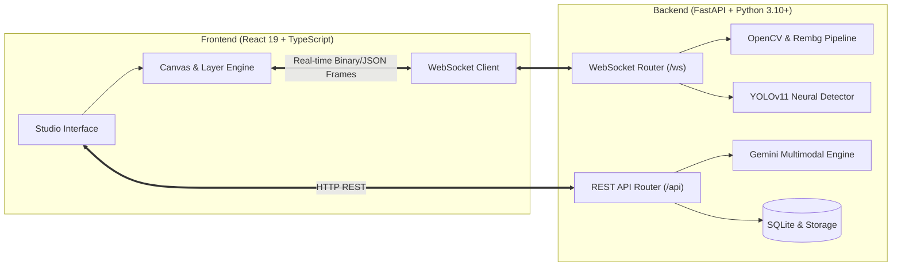

# 🎨 Ultimate Vision Studio

[](https://react.dev/)
[](https://www.typescriptlang.org/)
[](https://fastapi.tiangolo.com/)
[](https://opencv.org/)
[](https://github.com/ultralytics/ultralytics)
[](https://ai.google.dev/)
[](https://tailwindcss.com/)
[](LICENSE)

An enterprise-grade, full-stack **Computer Vision & Layer-based Image Processing Studio**. Ultimate Vision Studio bridges browser-based graphical editing with a backend powered by **FastAPI**, **OpenCV**, **YOLOv11**, and **Google Gemini Multimodal AI**.

---

## 🌟 Key Features

### 1. 🖼️ Multi-Layer Canvas Engine (Frontend)
- **Layer Stack Management:** Reorder, hide, lock, duplicate, and set opacity across unlimited raster, vector, text, and mask layers.
- **Blending Modes:** Industry-standard blend modes (Normal, Multiply, Screen, Overlay, Darken, Lighten, Color Dodge, etc.).
- **Vector & Shape Tools:** Parametric shapes, Bézier curves, freehand drawing, and customizable typography.
- **Export Capabilities:** Export to PNG, JPEG, SVG vector trace, PDF user reports, and DOCX documents.

### 2. ⚡ High-Performance Vision Pipeline (Backend)
- **Spatial Filters & Convolution:** Gaussian blur, bilateral filtering, Laplacian edge detection, Sobel, Canny, and sharpening kernels.
- **Tone Adjustments & Color Grading:** Parametric brightness, contrast, gamma correction, saturation, and histogram equalization.
- **Point & Morphological Operations:** Adaptive thresholding, Otsu binarization, dilation, erosion, opening, and closing.
- **Background Removal:** Automatic foreground isolation using high-precision neural segmentation.
- **Image Inpainting:** Intelligent object removal and surface reconstruction using Telea and Navier-Stokes algorithms.
- **Vectorization:** Potrace-style bitmap-to-SVG contour tracing.

### 3. 🤖 Deep Learning & Multimodal AI
- **YOLOv11 Object Detection:** Real-time object identification and bounding-box localization with confidence scoring.
- **Google Gemini Multimodal AI:** Natural language image inspection, automated descriptive captioning, and semantic suggestions.
- **Low-Latency Streaming:** Bidirectional WebSocket protocol for zero-latency image transformation previews.

---

## 🏛️ System Architecture



---

## 📂 Project Structure

```text
ultimate-vision-studio/
├── frontend/                          # Client-side React 19 application
│   ├── src/
│   │   ├── components/                # UI Modals, Canvas, Panels, Toolbars
│   │   ├── lib/                       # Engines (Canvas, CV, Gradient, Shape, WS)
│   │   ├── App.tsx                    # Master Studio Workspace
│   │   └── types.ts                   # Core TypeScript definitions
│   ├── public/                        # Static assets and manual downloads
│   ├── index.html                     # HTML5 entry template
│   ├── vite.config.ts                 # Vite bundler configuration
│   ├── tsconfig.json                  # TypeScript compiler settings
│   └── package.json                   # Frontend dependencies
├── backend/                           # High-performance FastAPI server
│   ├── core/                          # Base utilities & image encoding
│   ├── db/                            # SQLite connection & schemas
│   ├── services/                      # Authentication & cloud project storage
│   ├── vision/                        # Algorithmic OpenCV & YOLO modules
│   │   ├── spatial.py                 # Blurs, sharpening, edge filters
│   │   ├── tone.py                    # Curves, contrast, gamma, equalization
│   │   ├── point.py                   # Thresholding and morphology
│   │   ├── detection.py               # Ultralytics YOLOv11 integration
│   │   ├── inpaint.py                 # Telea and NS restoration
│   │   ├── background.py              # Foreground mask generation
│   │   └── vector.py                  # SVG contour tracing
│   ├── ai_engine.py                   # Google Gemini Vision integration
│   ├── main.py                        # FastAPI application entrypoint
│   ├── requirements.txt               # Python package dependencies
│   └── yolo11s.pt                     # YOLOv11 small weights
├── docs/                              # Project documentation & user manuals
│   ├── Ultimate_Vision_Studio_User_Manual.pdf  # Comprehensive user guide
│   ├── manual_print.html              # Printable HTML manual
│   ├── app_overview.png               # Application screenshot
│   └── ARCHITECTURE.md                # Technical architecture breakdown
├── tests/                             # Automated test suite
│   ├── test_vision_pipeline.py        # OpenCV processing pipeline tests
│   └── test_api_endpoints.py          # FastAPI endpoint verification
├── .gitignore                         # Git exclusion rules
├── LICENSE                            # MIT Open Source License
├── TEAM.md                            # Project author credits
├── README.md                          # Repository documentation
└── package.json                       # Monorepo root configuration
```

---

## 🚀 Quick Start Guide

### Prerequisites
- **Node.js** (v18.0 or newer)
- **Python** (v3.10 or newer)

### 1. Clone the Repository
```bash
git clone https://github.com/OmerGaber-hub/ultimate-vision-studio.git
cd ultimate-vision-studio
```

### 2. Backend Setup
```bash
cd backend
python -m venv venv

# Activate virtual environment:
# On Windows:
.\venv\Scripts\activate
# On Linux/macOS:
source venv/bin/activate

pip install -r requirements.txt
cp .env.example .env   # Configure GEMINI_API_KEY if using AI features
uvicorn main:app --reload --port 8000
```

### 3. Frontend Setup
In a new terminal window:
```bash
cd frontend
npm install
npm run dev
```
Open [http://localhost:5173](http://localhost:5173) in your browser to launch the studio.

---

## 🧪 Running Tests

To run the automated Python test suite covering image processing algorithms and API routes:
```bash
python -m unittest discover tests
```

---

## 👥 Authors & Team

Developed by:
- **Omer Farooq Gaber (عمر فاروق جابر)**
- **Tawfeeq Al-Oqab (توفيق العقاب)**
- **Mohammed Al-Marhabi (محمد المرهبي)**

---

## 📄 License

This project is licensed under the [MIT License](LICENSE).
