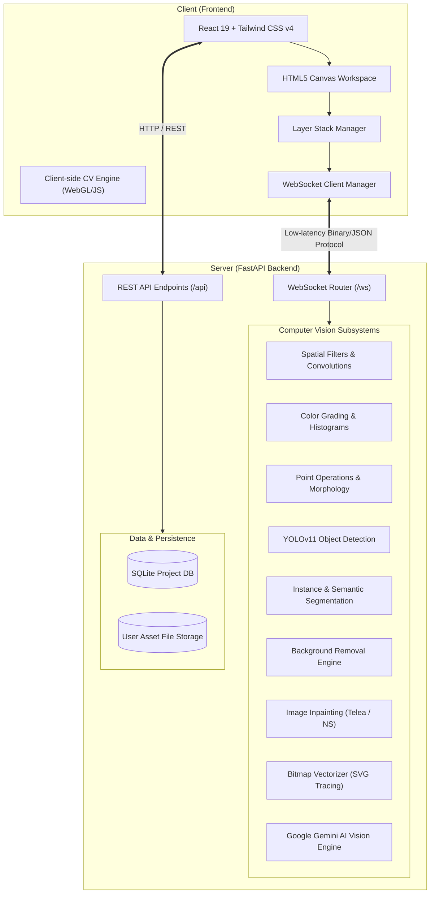

# 🏛️ Ultimate Vision Studio Architecture & System Specification

This document provides an engineering overview of the **Ultimate Vision Studio** system architecture, data flow, communication protocols, and processing pipelines.

---

## 1. High-Level Architecture Overview

Ultimate Vision Studio follows a modern, decoupled client-server architecture designed for real-time computer vision and interactive layer-based image editing.



---

## 2. Directory Layout & Modular Structure

```text
Ultimate-Vision-Studio/
├── frontend/                          # Client-side React 19 Application
│   ├── src/
│   │   ├── components/                # Modular UI components (Panels, Canvas, Modals)
│   │   ├── lib/                       # Engines (Canvas, CV, Gradient, Shape, WebSocket)
│   │   ├── App.tsx                    # Master Workspace Orchestrator
│   │   └── types.ts                   # Core TypeScript type definitions
│   ├── public/                        # Static assets and templates
│   ├── index.html                     # Application entry point
│   └── vite.config.ts                 # Build config & proxy routing
├── backend/                           # High-performance FastAPI Server
│   ├── core/                          # Base utilities & image encoding/decoding
│   ├── db/                            # Database connection & schema migration
│   ├── services/                      # Authentication & user asset storage
│   ├── vision/                        # OpenCV, Rembg, and YOLO algorithmic modules
│   │   ├── spatial.py                 # Kernels, blurs, edges, sharpening
│   │   ├── tone.py                    # Curves, contrast, gamma, equalization
│   │   ├── point.py                   # Thresholding, bitwise operations
│   │   ├── detection.py               # Ultralytics YOLOv11 detector
│   │   ├── segmentation.py            # Contour & mask extraction
│   │   ├── inpaint.py                 # Telea and Navier-Stokes restoration
│   │   ├── background.py              # Foreground extraction
│   │   └── vector.py                  # Potrace-style SVG tracing
│   ├── ai_engine.py                   # Google Gemini Vision integration
│   ├── main.py                        # FastAPI startup, REST & WebSocket routers
│   └── yolo11s.pt                     # YOLOv11 small weights
├── docs/                              # Project manual, architecture specs & diagrams
│   ├── Ultimate_Vision_Studio_User_Manual.pdf
│   ├── manual_print.html
│   ├── app_overview.png
│   └── ARCHITECTURE.md
├── tests/                             # Automated unit & integration tests
│   ├── test_vision_pipeline.py        # OpenCV processing pipeline verification
│   └── test_api_endpoints.py          # FastAPI testclient assertions
├── .gitignore                         # Git exclusion rules
├── LICENSE                            # MIT License
└── README.md                          # Repository documentation
```

---

## 3. Real-Time Communication Protocol (WebSockets)

For zero-latency image processing, the client establishes a persistent bidirectional WebSocket connection:

### Client $\rightarrow$ Server Frame
```json
{
  "action": "apply_spatial_filter",
  "layer_id": "layer_001",
  "image": "data:image/png;base64,iVBORw0KGgoAAAANSUhEUgAA...",
  "config": {
    "type": "gaussian_blur",
    "kernel_size": 7,
    "sigma": 2.5
  }
}
```

### Server $\rightarrow$ Client Response
```json
{
  "status": "success",
  "layer_id": "layer_001",
  "image": "data:image/png;base64,iVBORw0KGgoAAAANSUhEUgAA...",
  "metadata": {
    "execution_time_ms": 14.8,
    "dimensions": [1920, 1080],
    "channels": 4
  }
}
```

---

## 4. Multi-Layer Canvas Compositing

The client-side canvas engine manages an ordered stack of heterogeneous layers:
- **Raster Layers:** Pixel buffers with independent blend modes (`multiply`, `screen`, `overlay`, `darken`, etc.).
- **Vector & Shape Layers:** High-precision geometric shapes, paths, and Bezier curves.
- **Text Layers:** Dynamic typography rendering with alignment and font caching.
- **Mask Layers:** Alpha-channel blending and clipping masks.
